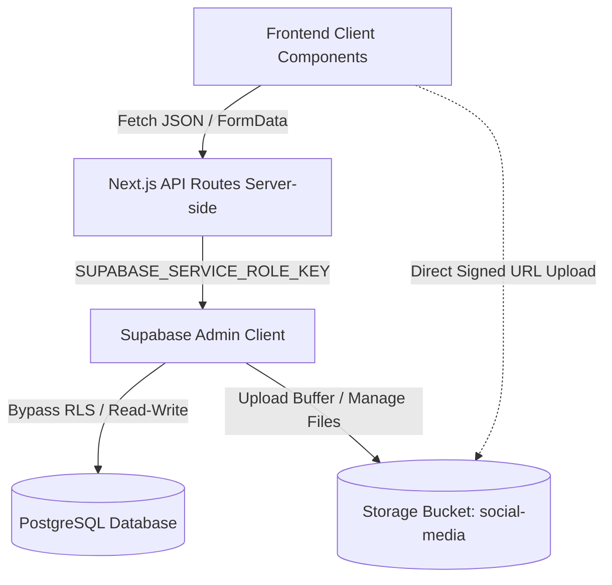
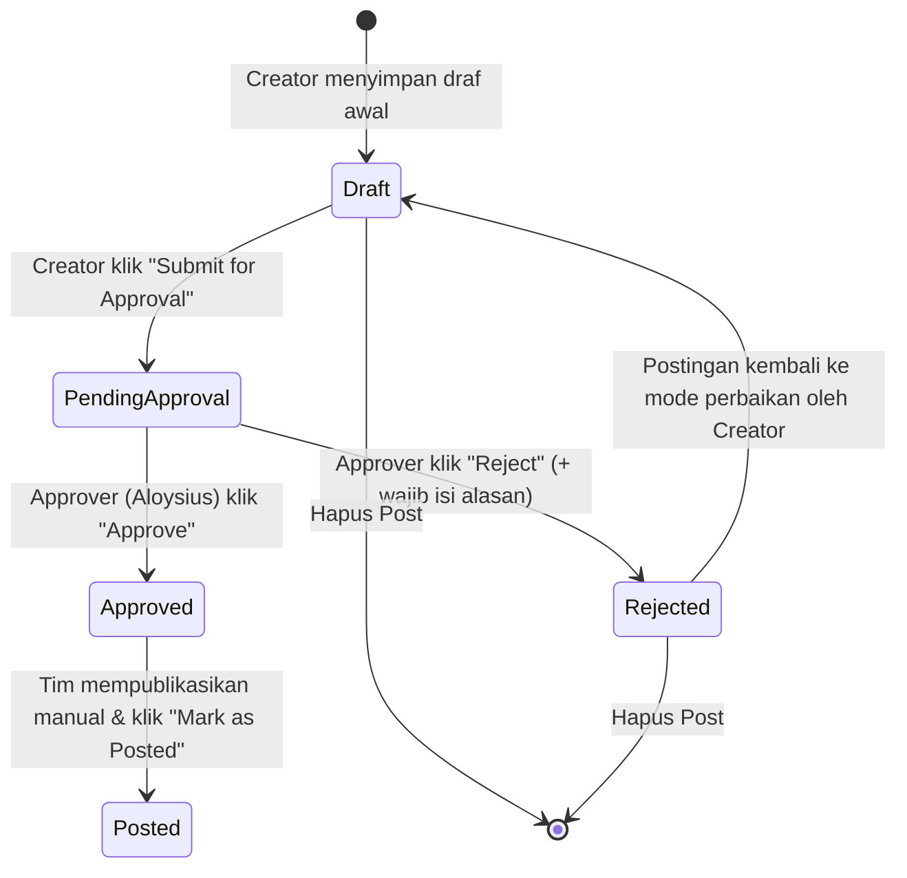
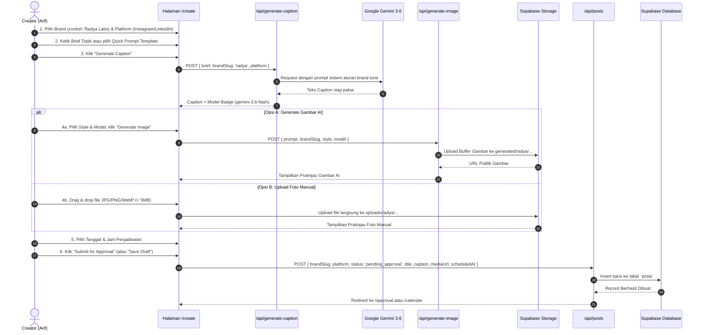
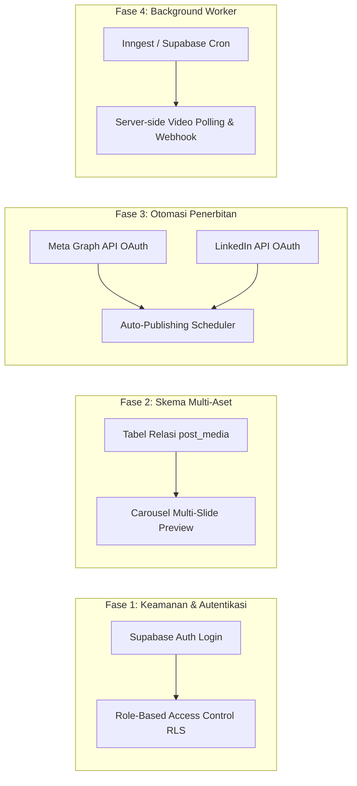

# Panduan Handover & Dokumentasi Arsitektur Radya Labs Social Media Manager

> **Dokumen Resmi Handover Pengembang & Dokumentasi Sistem**  
> Proyek: **Radya Labs Social Media Content Manager** (`radya-social`)  
> Framework: **Next.js 15 (App Router)** | **React 19** | **TypeScript** | **Supabase** | **Google Gemini**  
> Tanggal Dokumen: Oktober 2026

---

## Daftar Isi
1. [Bab 1: Ikhtisar Proyek & Arsitektur Sistem](#bab-1-ikhtisar-proyek--arsitektur-sistem)
   - [1.1 Latar Belakang & Tujuan Aplikasi](#11-latar-belakang--tujuan-aplikasi)
   - [1.2 Karakteristik Multi-Brand](#12-karakteristik-multi-brand)
   - [1.3 Tech Stack & Dependensi Utama](#13-tech-stack--dependensi-utama)
   - [1.4 Struktur Direktori & Peran Modul](#14-struktur-direktori--peran-modul)
2. [Bab 2: Supabase — Cara Kerja, Arsitektur, Skema & Alur Data](#bab-2-supabase--cara-kerja-arsitektur-skema--alur-data)
   - [2.1 Peran Supabase dalam Ekosistem Aplikasi](#21-peran-supabase-dalam-ekosistem-aplikasi)
   - [2.2 Arsitektur Koneksi & Autentikasi (Client, Server & Admin)](#22-arsitektur-koneksi--autentikasi-client-server--admin)
   - [2.3 Skema Basis Data PostgreSQL](#23-skema-basis-data-postgresql)
   - [2.4 Supabase Storage (Bucket & Struktur File)](#24-supabase-storage-bucket--struktur-file)
   - [2.5 Row Level Security (RLS) & Kebijakan Akses](#25-row-level-security-rls--kebijakan-akses)
   - [2.6 Diagnostic & Health Check Endpoint (`/api/health`)](#26-diagnostic--health-check-endpoint-apihealth)
   - [2.7 Panduan Setup Supabase dari Awal](#27-panduan-setup-supabase-dari-awal)
3. [Bab 3: Alur Siklus Hidup Pembuatan Konten (Content Lifecycle Workflow)](#bab-3-alur-siklus-hidup-pembuatan-konten-content-lifecycle-workflow)
   - [3.1 Diagram Status Konten](#31-diagram-status-konten)
   - [3.2 Tahapan Pembuatan Konten (End-to-End)](#32-tahapan-pembuatan-konten-end-to-end)
   - [3.3 Alur Penerbitan Konten (Manual Posting Toolkit)](#33-alur-penerbitan-konten-manual-posting-toolkit)
4. [Bab 4: Penjelasan Detail Setiap Halaman & Fitur Dashboard](#bab-4-penjelasan-detail-setiap-halaman--fitur-dashboard)
   - [4.1 Dashboard Overview (`/dashboard`)](#41-dashboard-overview-dashboard)
   - [4.2 Content Calendar (`/calendar`)](#42-content-calendar-calendar)
   - [4.3 Content Creation — Post Gambar & Caption (`/create`)](#43-content-creation--post-gambar--caption-create)
   - [4.4 Content Creation — Video AI Multi-Mode (`/create/video`)](#44-content-creation--video-ai-multi-mode-createvideo)
   - [4.5 Approval Queue & Manajemen Peran (`/approval`)](#45-approval-queue--manajemen-peran-approval)
   - [4.6 Modal Komponen & Utilitas Pendukung](#46-modal-komponen--utilitas-pendukung)
5. [Bab 5: Evaluasi Teknis, Catatan yang Belum Sempurna & Rekomendasi Pengembangan](#bab-5-evaluasi-teknis-catatan-yang-belum-sempurna--rekomendasi-pengembangan)
   - [5.1 Area yang Belum Sempurna (Current Limitations)](#51-area-yang-belum-sempurna-current-limitations)
   - [5.2 Rekomendasi Solusi & Roadmap Pengembangan (Future Improvements)](#52-rekomendasi-solusi--roadmap-pengembangan-future-improvements)
6. [Bab 6: Panduan Handover & Menjalankan Proyek Secara Mandiri](#bab-6-panduan-handover--menjalankan-proyek-secara-mandiri)
   - [6.1 Prasyarat Sistem & Kunci API](#61-prasyarat-sistem--kunci-api)
   - [6.2 Langkah Instalasi & Menjalankan Dev Server](#62-langkah-instalasi--menjalankan-dev-server)
   - [6.3 Konfigurasi File Lingkungan (`.env.local`)](#63-konfigurasi-file-lingkungan-envlocal)
   - [6.4 Checklist Troubleshooting Umum](#64-checklist-troubleshooting-umum)

---

## Bab 1: Ikhtisar Proyek & Arsitektur Sistem

### 1.1 Latar Belakang & Tujuan Aplikasi
**Radya Labs Social Media Content Manager** adalah platform internal all-in-one yang dirancang untuk mengelola, merencanakan, membuat aset berbasis Generative AI, dan menyetujui konten media sosial bagi ekosistem entitas bisnis **Radya Labs**.

Sistem ini memfasilitasi kolaborasi antara tim **Creator** (yang menyusun draf konten, prompt AI, gambar/video) dan tim **Approver** (pimpinan atau editorial lead yang meninjau kepatuhan brand dan menyetujui jadwal publikasi sebelum diposting).

### 1.2 Karakteristik Multi-Brand
Sistem ini menangani 4 entitas brand yang memiliki target audiens dan tone of voice yang sangat spesifik:

| Brand Slug | Nama Brand | Target Audiens | Tone of Voice & Karakter |
| :--- | :--- | :--- | :--- |
| `radya` | **Radya Labs** | Perusahaan skala besar, perbankan, BUMN, instansi pemerintah (bukan UMKM). | Otoritatif, berbasis solusi sistem kritis nasional, kredibel, siap uji tuntas (*due-diligence ready*), tanpa gaya jualan *hypey*. |
| `alkademi` | **Alkademi** | Mahasiswa teknologi, fresh graduates, programmer pemula. | Edukatif, suportif, ramah, menginspirasi karier rekayasa perangkat lunak nyata. |
| `jangkau` | **Jangkau** | Pemilik UMKM di Indonesia. | Praktis, solutif, fokus pada manfaat otomatisasi chat WhatsApp/Instagram untuk meningkatkan omzet bisnis. |
| `sinaptik` | **Sinaptik** | Pemangku kepentingan pelatihan korporat (*corporate training*). | Profesional bersahaja (*understated*), formal, fokus pada dokumentasi portofolio pelatihan enterprise. |

### 1.3 Tech Stack & Dependensi Utama
- **Core Framework**: Next.js 15.1.7 (menggunakan **App Router** modern).
- **Runtime & UI**: React 19.0.0, TypeScript 5, Tailwind CSS 3.4.17.
- **Ikonografi & Desain**: Lucide React 0.475.0, Tailwind Merge, CLSX.
- **Basis Data & Storage**: Supabase (`@supabase/supabase-js` v2.48.1 & `@supabase/ssr` v0.5.2).
- **Generative AI (Teks/Caption)**: Google GenAI SDK (`@google/genai` v2.21.0) dengan model Gemini 3.6/3.5/2.5 Flash.
- **Generative AI (Gambar & Video)**: Gateway NewAPI kompatibel OpenAI API (`gpt-image-2.5-sunburst-4k`, `wan-3.0-720p/1080p`, `grok-imagine-video`, `seedance-2.0`).

### 1.4 Struktur Direktori & Peran Modul
```text
radya-social/
├── src/
│   ├── app/                               # Next.js App Router Pages & API Routes
│   │   ├── api/                           # Backend Server Routes
│   │   │   ├── generate-caption/          # Endpoint integrasi Gemini text
│   │   │   ├── generate-image/            # Endpoint integrasi image generator & Supabase storage
│   │   │   ├── generate-video/            # Endpoint pembuatan & polling task video AI
│   │   │   ├── health/                    # Diagnostic konektivitas DB, Storage & AI API
│   │   │   ├── posts/                     # CRUD lengkap entitas posts ke Supabase DB
│   │   │   ├── upload-image/              # Upload file foto manual ke Supabase Storage
│   │   │   └── video-reference-upload/    # Signed URL upload referensi video ke Storage
│   │   ├── approval/                      # Halaman antrean persetujuan (Approval Queue)
│   │   ├── calendar/                      # Halaman kalender konten (Month/Week/Day)
│   │   ├── create/                        # Halaman pembuatan konten gambar & caption
│   │   │   └── video/                     # Halaman studio kreasi video AI multi-mode
│   │   ├── dashboard/                     # Halaman metrik analitik & snapshot IG Insights
│   │   ├── globals.css                    # Definisi tema warna (Navy theme & CSS tokens)
│   │   └── layout.tsx                     # Shell aplikasi utama + Provider konteks
│   ├── components/                        # Komponen UI Reusable
│   │   ├── ManualMetricsModal.tsx         # Modal pencatatan manual metrik media sosial
│   │   ├── PostDetailModal.tsx            # Modal pratinjau detail postingan & tindakan cepat
│   │   ├── RejectModal.tsx                # Modal pengembalian draf dengan catatan revisi
│   │   ├── Sidebar.tsx                    # Navigasi utama, status antrean, toggle role & tema
│   │   └── Toast.tsx                      # Sistem notifikasi interaktif real-time
│   └── lib/                               # Logika Bisnis, Utilitas & Integrasi
│       ├── brands.ts                      # Kamus konfigurasi 4 brand & arsip postingan historis
│       ├── context/AppContext.tsx         # React Context global penampung state postingan & user
│       ├── gemini.ts                      # Service pembuat caption otomatis menggunakan Google GenAI
│       ├── image-models.ts                # Daftar model generator gambar & urutan fallback
│       ├── provider-errors.ts             # Penerjemah error API pihak ketiga menjadi pesan ramah
│       ├── radya-insights.ts              # Data snapshot metrik resmi Instagram @radyalabs
│       ├── supabase/                      # Lapisan integrasi Supabase
│       │   ├── client.ts                  # Inisialisasi Supabase Browser Client (SSR-safe)
│       │   ├── repository.ts              # Helper pemetaan baris DB ke interface Post frontend
│       │   └── server.ts                  # Inisialisasi Supabase Server Client dengan cookie
│       ├── types.ts                       # Definisi TypeScript (Post, Brand, Metrics, dll)
│       └── video.ts                       # Validasi request, payload builder & preset video
├── supabase/
│   ├── schema.sql                         # Skrip DDL tabel, indeks, bucket storage & RLS
│   └── seed.sql                           # Data inisial entitas brand dan pengguna default
├── docs/                                  # Dokumentasi teknis & spesifikasi pengembangan
├── .env.example                           # Cetak biru konfigurasi environment variables
├── package.json                           # Manifes dependensi & skrip eksekusi
└── tsconfig.json                          # Konfigurasi compiler TypeScript
```

---

## Bab 2: Supabase — Cara Kerja, Arsitektur, Skema & Alur Data

### 2.1 Peran Supabase dalam Ekosistem Aplikasi
Supabase berfungsi sebagai **tulang punggung penyimpanan data terpusat (Backbone Data Layer)** untuk aplikasi ini:
1. **PostgreSQL Database**: Menyimpan master data brand, daftar pengguna internal, dan siklus hidup postingan konten (`posts`).
2. **Object Storage**: Menyimpan seluruh berkas visual (gambar hasil generasi AI, foto hasil unggahan manual kreator, serta aset referensi wajah/poster/video untuk studio video) di dalam bucket publik bernama `social-media`.

### 2.2 Arsitektur Koneksi & Autentikasi (Client, Server & Admin)
Sistem ini menggunakan pemisahan akses keamanan berlapis:


1. **Client / Browser Side (`src/lib/supabase/client.ts`)**:
   - Menggunakan `createBrowserClient` dari `@supabase/ssr` dengan kunci `NEXT_PUBLIC_SUPABASE_ANON_KEY`.
   - Hanya memiliki izin baca sesuai aturan RLS jika diakses langsung dari peramban.
2. **Server API Routes (`src/app/api/posts/route.ts`)**:
   - Memakai fungsi `getAdmin()` yang mengutamakan `SUPABASE_SERVICE_ROLE_KEY`.
   - Mengabaikan RLS agar operasi CRUD antartim internal berjalan mulus tanpa hambatan otorisasi token di sisi backend Next.js.
3. **Signed Upload URL (`src/app/api/video-reference-upload/route.ts`)**:
   - Server membuat token pengunggahan bertanda tangan (*signed upload URL*) sementara, memungkinkan file berukuran besar diunggah langsung dari browser pengguna ke Supabase Storage tanpa membebani memori server Next.js.

### 2.3 Skema Basis Data PostgreSQL
Skema database didefinisikan secara lengkap di [`supabase/schema.sql`](file:///c:/Users/Jundi%20HD/.gemini/antigravity/scratch/radya-social/supabase/schema.sql).

#### 1. Tabel `brands`
Menyimpan entitas merek bisnis yang dinaungi.
```sql
create table if not exists brands (
  id uuid primary key default gen_random_uuid(),
  slug text unique not null,               -- 'radya' | 'alkademi' | 'jangkau' | 'sinaptik'
  name text not null,                      -- Nama tampilan merek
  audience_summary text not null,          -- Target audiens spesifik
  tone_context text not null,              -- Panduan nada bicara untuk prompt AI
  created_at timestamptz default now()
);
```

#### 2. Tabel `users`
Menyimpan profil tim internal beserta perannya.
```sql
create table if not exists users (
  id uuid primary key default gen_random_uuid(),
  email text unique not null,
  name text not null,
  role text check (role in ('creator', 'approver')) not null default 'creator',
  created_at timestamptz default now()
);
```

#### 3. Tabel `posts`
Menyimpan seluruh postingan konten media sosial dan siklus hidup statusnya.
```sql
create table if not exists posts (
  id uuid primary key default gen_random_uuid(),
  brand_id uuid references brands(id) on delete cascade,
  brand_slug text not null default 'radya',
  platform text check (platform in ('instagram', 'linkedin')) not null default 'instagram',
  status text check (status in ('draft', 'pending_approval', 'approved', 'posted', 'rejected')) default 'draft',
  title text not null,                     -- Judul singkat atau topik konten
  caption text default '',                 -- Teks lengkap caption media sosial
  media_url text,                          -- URL publik file gambar/video di Supabase Storage
  scheduled_at timestamptz,                -- Jadwal posting tanggal & waktu (ISO)
  created_by text,                         -- Nama atau email pembuat
  rejection_comment text,                  -- Catatan revisi wajib dari Approver jika ditolak
  created_at timestamptz default now(),
  updated_at timestamptz default now()
);

-- Indeks performa pencarian
create index if not exists idx_posts_scheduled on posts(scheduled_at);
create index if not exists idx_posts_status on posts(status);
create index if not exists idx_posts_brand on posts(brand_slug);
```

### 2.4 Supabase Storage (Bucket & Struktur File)
Sistem menggunakan satu bucket utama bernama `social-media` yang berstatus **Public**:
- **Bucket ID**: `social-media` (Public: `true`)
- **Struktur Folder Terorganisir**:
  * `generated/{brand_slug}/{timestamp}-{uuid}.{png|jpg|webp}`: File gambar hasil dari model AI.
  * `uploads/{brand_slug}/{timestamp}-{uuid}-{filename}.{ext}`: File gambar yang diunggah manual oleh tim kreator.
  * `video-references/{mode}/{timestamp}-{uuid}.{ext}`: File gambar wajah, poster, atau video sumber yang diunggah untuk referensi video generator.

Setiap file yang berhasil disimpan akan langsung mendapatkan `publicUrl` yang kemudian disimpan ke kolom `media_url` pada tabel `posts`.

### 2.5 Row Level Security (RLS) & Kebijakan Akses
Semua tabel mengaktifkan RLS (`enable row level security`) dengan kebijakan yang disesuaikan untuk sistem *internal company tool*:
- `brands`: Terbuka untuk dibaca (`select using (true)`).
- `posts`:
  * Baca: Diizinkan untuk semua pengguna internal (`select using (true)`).
  * Insert: Diizinkan untuk anonim/terotentikasi (`insert with check (true)`).
  * Update: Diizinkan untuk memperbarui status dan konten (`update using (true)`).
  * Delete: Diizinkan untuk menghapus draf (`delete using (true)`).
- Storage `social-media`: Objek dapat dibaca secara publik oleh siapa saja melalui CDN Supabase.

### 2.6 Diagnostic & Health Check Endpoint (`/api/health`)
Aplikasi dilengkapi endpoint diagnostik mandiri di `GET /api/health`. Endpoint ini menguji 5 parameter secara bersamaan:
1. **Koneksi Supabase DB**: Menjalankan query `select count` ke tabel `posts`.
2. **Koneksi Supabase Storage**: Memeriksa keberadaan bucket `social-media`.
3. **Koneksi Google Gemini**: Mengirim prompt ringan ke model `gemini-3.6-flash`.
4. **Koneksi Gateway Video**: Memeriksa ketersediaan provider video via `GET /v1/models`.
5. **Koneksi Gateway Image**: Memeriksa ketersediaan provider gambar.

Jika salah satu layanan kritis tidak terhubung, endpoint akan mengembalikan HTTP 503 dengan rincian variabel lingkungan mana yang hilang.

### 2.7 Panduan Setup Supabase dari Awal
Bagi developer baru yang akan menghubungkan database sendiri:
1. Masuk ke [Supabase Dashboard](https://supabase.com) dan buat project baru.
2. Buka menu **Project Settings** → **API**. Salin 3 parameter:
   - `Project URL`
   - `Project API Keys` (ambil **anon / public** dan **service_role**).
3. Buka menu **SQL Editor** di dashboard Supabase Anda:
   - Buka file [`supabase/schema.sql`](file:///c:/Users/Jundi%20HD/.gemini/antigravity/scratch/radya-social/supabase/schema.sql), salin kodenya, lalu jalankan (**Run**).
   - Buka file [`supabase/seed.sql`](file:///c:/Users/Jundi%20HD/.gemini/antigravity/scratch/radya-social/supabase/seed.sql), salin kodenya, lalu jalankan (**Run**).
4. Masukkan kunci ke `.env.local`:
   ```bash
   NEXT_PUBLIC_SUPABASE_URL=https://xxxxxxxxxxxxxxxxxxxx.supabase.co
   NEXT_PUBLIC_SUPABASE_ANON_KEY=eyJhbGciOi...
   SUPABASE_SERVICE_ROLE_KEY=eyJhbGciOi...
   ```
5. Akses `http://localhost:3000/api/health` di browser. Pastikan `"connected": true`.

---

## Bab 3: Alur Siklus Hidup Pembuatan Konten (Content Lifecycle Workflow)

### 3.1 Diagram Status Konten
Setiap postingan bergerak dalam siklus hidup (*finite state machine*) berikut:



### 3.2 Tahapan Pembuatan Konten (End-to-End)



### 3.3 Alur Penerbitan Konten (Manual Posting Toolkit)
Pada versi saat ini (v1), sistem mengadopsi pendekatan **Human-in-the-Loop Publishing**:
1. Postingan yang telah berstatus `approved` akan membuka toolkit publikasi manual di halaman **Approval Queue** (`/approval`) dan modal detail postingan (`PostDetailModal`).
2. Tim social media officer mengklik:
   - **Copy Caption**: Menyalin caption beserta susunan spasi dan tagar yang telah disetujui ke clipboard peramban.
   - **Download Image / Video**: Mengunduh aset visual resolusi tinggi dengan penamaan otomatis.
   - **Buka Instagram / LinkedIn**: Mengunggah aset ke aplikasi resmi media sosial.
   - **Mark as Live / Posted**: Mengubah status postingan di database menjadi `posted` untuk menandai bahwa konten telah tayang.

---

## Bab 4: Penjelasan Detail Setiap Halaman & Fitur Dashboard

### 4.1 Dashboard Overview (`/dashboard`)
Halaman analitik sentral yang menampilkan performa media sosial.
- **Brand Switcher Pills**: Memungkinkan perpindahan konteks antara Radya Labs, Alkademi, Jangkau, dan Sinaptik.
- **Snapshot Instagram @radyalabs**:
  * Menampilkan metrik nyata periode 30 hari (18 Agustus – 17 September):
    * **Followers**: 628 pengikut (+9 net growth).
    * **Views**: 13.266 total tayangan (porsi 7.1% pengikut vs 92.9% bukan pengikut).
    * **Interactions**: 389 interaksi dari 10.435 penonton unik.
    * **Profile Visits**: 633 kunjungan profil & 58 ketukan tautan bio.
- **Breakdown Grafik**:
  * *Views by content type*: Membandingkan performa Reels (12.943), Post biasa (323), dan Stories.
  * *Interactions by content type*: Rasio interaksi per format postingan.
  * *Audience Demographics*: Komposisi gender (57.1% pria, 42.9% wanita), rentang usia (paling dominan usia produktif 25–34 tahun sebesar 48.9%), dan asal negara utama (Indonesia, Singapura, AS).
- **Top Content Ranking Table**: Daftar peringkat konten dengan jumlah penonton dan interaksi tertinggi.
- **Recent Reference Archive**: Kartu arsip referensi postingan nyata dari feed Instagram @radyalabs (Carousel, Video, Photo).
- **Log Metrics Modal (`ManualMetricsModal.tsx`)**: Fitur untuk mencatat metrik manual secara berkala yang disimpan di `localStorage` sebagai pencatatan operasional v1.
- **Unconnected Brand State**: Tampilan jujur (*honest UI*) saat memilih Alkademi, Jangkau, atau Sinaptik yang menginformasikan bahwa akun sosial mereka belum ditautkan di v1, dilengkapi tombol pintas untuk langsung membuat draf konten baru.

### 4.2 Content Calendar (`/calendar`)
Kalender visual interaktif untuk perencanaan jangka pendek dan panjang.
- **Tampilan Tiga Mode**:
  1. **Month View**: Grid kalender penuh 42 sel (6 minggu) yang menyinkronkan hari pertama dan penutup bulan.
  2. **Week View**: Tampilan horizontal 7 hari berjalan untuk memantau ritme postingan mingguan.
  3. **Day View**: Tampilan terfokus per hari dengan rincian jadwal per jam.
- **Navigasi Tanggal**: Tombol navigasi bulan sebelumnya (`<`), bulan berikutnya (`>`), dan tombol cepat `Today`.
- **Status Chip Berwarna**:
  * `draft`: Abu-abu (*slate*).
  * `pending_approval`: Kuning (*amber*).
  * `approved`: Biru muda (*blue*).
  * `posted`: Hijau (*emerald*).
  * `rejected`: Merah jambu (*rose*).
  * Dilengkapi ikon platform (Instagram atau LinkedIn).
- **Interaktivitas Klik**:
  * Klik pada sel tanggal kosong: Langsung mengarahkan ke halaman kreasi dengan tanggal yang otomatis terisi (`/create?date=YYYY-MM-DD`).
  * Klik pada chip postingan: Membuka modal detail postingan untuk melihat caption, media, dan melakukan aksi cepat.

### 4.3 Content Creation — Post Gambar & Caption (`/create`)
Studio penyusunan konten visual statis dan teks.
- **Brand & Platform Picker**: Mengubah gaya penulisan AI secara instan sesuai profil merek yang dipilih.
- **Quick Prompt Template**: Tombol pintas berisi ide konten yang disesuaikan dengan fokus bisnis masing-masing merek (misal: studi kasus perbankan untuk Radya Labs, tips coding untuk Alkademi).
- **AI Caption Generator**:
  * Terkoneksi ke Google Gemini (`gemini-3.6-flash`).
  * Menggunakan sistem prompt khusus yang menyuntikkan target audiens dan aturan tone of voice brand.
  * Menampilkan badge model AI yang digunakan secara transparan di antarmuka.
- **Dual Visual Creation Mode**:
  1. *Mode Generate AI*: Memanfaatkan model generasi gambar (default `gpt-image-2.5-sunburst-4k` dengan fallback Gemini image) dengan berbagai gaya visual (*Photorealistic*, *Corporate illustration*, *Minimalist flat*, dll). Hasil langsung diunggah otomatis ke Supabase Storage.
  2. *Mode Upload Manual*: Drag-and-drop file gambar (JPG, PNG, WebP) hingga 5MB dengan pratinjau instan sebelum disimpan ke Supabase Storage.
- **Mode Penyuntingan Konten (`?edit=[id]`)**: Jika dibuka dari tombol edit, formulir akan memuat data postingan yang sudah ada dan memperbarui baris database tanpa membuat duplikasi.

### 4.4 Content Creation — Video AI Multi-Mode (`/create/video`)
Studio video generasi kecerdasan buatan berbasis task asinkron.
- **4 Mode Generasi Video**:
  1. **Prompt Only**: Membuat video murni dari deskripsi narasi teks.
  2. **Face Reference**: Mengunggah foto wajah referensi agar karakter pemeran dalam video tetap konsisten (*character facial consistency*).
  3. **Poster Reference**: Mengunggah poster atau desain grafis statis untuk dianimasikan menjadi video dinamis.
  4. **Video Reference**: Mengunggah video sumber untuk meremix gaya gerak kamera dan suasana visual.
- **Rasio Aspek & Durasi**:
  * Rasio: `9:16 Reel` (720x1280), `16:9 Wide` (1280x720), atau `1:1 Square` (1024x1024).
  * Durasi: 5 detik atau 10 detik.
- **Preset Gaya Video**: *Talking Head Viral*, *Product Story*, *UGC Review*, dan *Cinematic Promo*.
- **Peningkatan Visual (Enhancements)**: *Strong Hook*, *Bold Captions*, *Dynamic Camera*, dan *Keep Centered*.
- **Polling Status & Persistensi Lokal**:
  * Karena pembuatan video AI memakan waktu 1–3 menit, sistem menjalankan polling interval `GET /api/generate-video?id=task_xxx` dan menampilkan bilah progres interaktif.
  * Task ID disimpan di `localStorage` (`radya_video_task`), sehingga bila halaman tidak sengaja di-*refresh*, proses pembuatan tidak akan hilang.
- **Bridge Caption Video**: Tombol pintas untuk langsung men-generate caption sosial media yang selaras dengan topik video yang baru dibuat.

### 4.5 Approval Queue & Manajemen Peran (`/approval`)
Pusat kendali persetujuan sebelum konten dirilis ke publik.
- **Peralihan Peran di Sidebar (Role Switcher)**:
  * **Aloysius (Approver)**: Memiliki hak penuh untuk meninjau, menyetujui (*Approve*), atau menolak (*Reject*).
  * **Arif (Creator)**: Memiliki hak untuk menyusun draf, mengajukan untuk disetujui (*Submit*), dan memperbaiki konten yang ditolak.
- **Tab Filter**:
  * `Pending Approval`: Menampilkan draf yang sedang menunggu tinjauan Approver.
  * `Approved`: Menampilkan konten yang telah disetujui dan siap dipublikasikan via toolkit manual.
  * `Drafts`: Draf yang masih dalam pengerjaan Creator.
  * `All`: Semua postingan tanpa filter.
- **Tindakan Penolakan Berbasis Catatan (`RejectModal.tsx`)**: Approver wajib menuliskan alasan revisi yang jelas (misal: "Gaya bahasa terlalu santai, tolong hilangkan emoji dan tekankan sertifikasi ISO"). Postingan otomatis kembali ke status `draft` dan catatan penolakan ditampilkan dengan jelas kepada Creator.

### 4.6 Modal Komponen & Utilitas Pendukung
1. **`PostDetailModal.tsx`**:
   - Menampilkan kartu pratinjau lengkap postingan sesuai format Instagram/LinkedIn.
   - Menyediakan tombol aksi cepat: Salin Caption, Unduh Gambar, Setujui, Tolak, Edit, atau Hapus.
2. **`RejectModal.tsx`**:
   - Menjamin bahwa tidak ada postingan yang ditolak tanpa instruksi revisi yang jelas.
3. **`ManualMetricsModal.tsx`**:
   - Memfasilitasi input manual metrik pengikut, postingan bulanan, engagement rate, dan reach untuk pembaruan kartu statistik dashboard.
4. **`Sidebar.tsx`**:
   - Navigasi responsif (berpindah antara desktop sidebar vertikal dan mobile header navigasi).
   - Indikator *badge* jumlah postingan yang sedang menunggu persetujuan (*Pending Count*).
   - Pengalih tema gelap/terang (*Dark/Light Mode Switcher*) yang tersimpan di `localStorage`.
5. **`Toast.tsx`**:
   - Memberikan umpan balik instan (sukses, peringatan, error) dengan animasi yang rapi dan durasi otomatis 4,5 detik.

---

## Bab 5: Evaluasi Teknis, Catatan yang Belum Sempurna & Rekomendasi Pengembangan

Berdasarkan tinjauan menyeluruh terhadap codebase saat ini, berikut adalah evaluasi objektif mengenai area yang masih berstatus Minimum Viable Product (MVP/v1) dan rekomendasi perbaikannya:

### 5.1 Area yang Belum Sempurna (Current Limitations)

#### 1. Autentikasi Pengguna & Otorisasi Peran Berbasis Sisi Klien
- **Kondisi Saat Ini**: Peralihan peran antara "Aloysius (Approver)" dan "Arif (Creator)" dikelola melalui `localStorage` dan state React di [`Sidebar.tsx`](file:///c:/Users/Jundi%20HD/.gemini/antigravity/scratch/radya-social/src/components/Sidebar.tsx). Tidak ada sesi login resmi (email/password atau SSO).
- **Implikasi**: Pengguna dapat dengan mudah mengubah nilai `localStorage` di devtools browser untuk mengambil alih peran Approver tanpa verifikasi sandi.

#### 2. Ketiadaan Integrasi Langsung ke Meta Graph API & LinkedIn API
- **Kondisi Saat Ini**: Metrik dashboard pada halaman `/dashboard` menggunakan snapshot statis Instagram Insights @radyalabs per September 2026 yang di-hardcode di [`src/lib/radya-insights.ts`](file:///c:/Users/Jundi%20HD/.gemini/antigravity/scratch/radya-social/src/lib/radya-insights.ts). Selain itu, tombol posting bersifat "Manual Publishing Toolkit".
- **Implikasi**: Data analitik tidak terbarukan secara otomatis dari server Meta/LinkedIn, dan tim masih harus mem-paste caption dan gambar secara manual ke aplikasi Instagram/LinkedIn.

#### 3. Polling Pembuatan Video AI di Sisi Browser Klien
- **Kondisi Saat Ini**: Pembuatan video AI memanggil endpoint pihak ketiga yang mengembalikan `task_id`. Polling pengecekan status berkala dilakukan di sisi browser (`useEffect` interval di [`create/video/page.tsx`](file:///c:/Users/Jundi%20HD/.gemini/antigravity/scratch/radya-social/src/app/create/video/page.tsx)).
- **Implikasi**: Jika browser ditutup sebelum video selesai di-generate, proses polling terhenti di klien, meskipun ID tugas masih tersimpan di `localStorage`.

#### 4. Keterbatasan Format Media Postingan (Single Media Field)
- **Kondisi Saat Ini**: Kolom pada tabel `posts` hanya menyediakan satu `media_url text`.
- **Implikasi**: Format Instagram Carousel (yang terdiri dari 3–10 lembar slide gambar) atau postingan multi-gambar belum memiliki skema array/relasi media terpisah.

#### 5. Kueri Postingan Tanpa Paginasi (Unpaginated Query)
- **Kondisi Saat Ini**: Endpoint `GET /api/posts` mengambil seluruh baris data dari tabel `posts` menggunakan `.select('*, brands(slug)')`.
- **Implikasi**: Untuk jumlah data ratusan postingan, performa masih sangat cepat. Namun bila data mencapai ribuan baris, konsumsi memori dan bandwidth transfer akan membengkak jika tidak dibatasi batas (*limit/offset*).

---

### 5.2 Rekomendasi Solusi & Roadmap Pengembangan (Future Improvements)

Untuk membawa sistem ini ke tingkat produksi enterprise (v2), tim pengembang berikutnya disarankan memprioritaskan perbaikan berikut:



#### 1. Rekomendasi 1: Terapkan Supabase Auth Penuh
- **Langkah Kerja**:
  * Aktifkan **Supabase Auth** (misalnya menggunakan Google Workspace SSO dengan domain `@radyalabs.com` atau email magic link).
  * Kaitkan `auth.uid()` dengan tabel `public.users`.
  * Terapkan RLS ketat di Supabase: hanya user dengan `users.role = 'approver'` yang dapat mengeksekusi perintah SQL `UPDATE posts SET status = 'approved'`.

#### 2. Rekomendasi 2: Restrukturisasi Skema untuk Dukungan Carousel
- **Langkah Kerja**:
  * Tambahkan tabel relasi baru `post_media`:
    ```sql
    create table post_media (
      id uuid primary key default gen_random_uuid(),
      post_id uuid references posts(id) on delete cascade,
      media_url text not null,
      media_type text check (media_type in ('image', 'video')) default 'image',
      sort_order int default 0,
      created_at timestamptz default now()
    );
    ```
  * Perbarui UI di `/create` agar mendukung pengunggahan banyak gambar sekaligus (Carousel Slider).

#### 3. Rekomendasi 3: Background Worker untuk Polling Video
- **Langkah Kerja**:
  * Pindahkan polling video dari browser ke server background job (misalnya menggunakan **Inngest**, **QStash**, atau **Supabase Edge Functions** terjadwal).
  * Ketika video selesai diproses oleh provider, server akan otomatis memperbarui database dan mengirimkan notifikasi email/webhook ke tim pembuat konten.

#### 4. Rekomendasi 4: Integrasi Langsung ke Meta Graph API & LinkedIn API
- **Langkah Kerja**:
  * Daftarkan aplikasi di [Meta for Developers](https://developers.facebook.com/) dan ajukan izin `instagram_content_publish` serta `instagram_manage_insights`.
  * Buat tabel penyimpan token OAuth: `brand_social_accounts (brand_id, platform, access_token, token_expires_at)`.
  * Tambahkan cron job harian untuk menyedot angka impressions, reach, dan engagement secara otomatis menggantikan snapshot statis.

#### 5. Rekomendasi 5: Paginasi & Pencarian pada Kalender/Approval
- **Langkah Kerja**:
  * Tambahkan parameter query `?limit=20&page=1&status=...` pada `GET /api/posts`.
  * Di kalender, filter data berdasarkan rentang tanggal aktif saja (`.gte('scheduled_at', startOfMonth).lte('scheduled_at', endOfMonth)`).

---

## Bab 6: Panduan Handover & Menjalankan Proyek Secara Mandiri

### 6.1 Prasyarat Sistem & Kunci API
Pastikan perangkat pengembang baru memenuhi spesifikasi berikut:
- **Node.js**: Versi `18.18.0` ke atas (disarankan Node.js 20 LTS).
- **Paket Manajer**: `npm` (atau `pnpm` / `yarn`).
- **Akun Layanan**:
  1. Akun [Supabase](https://supabase.com) (Gratis/Pro).
  2. Akun [Google AI Studio](https://aistudio.google.com/) untuk memperoleh `GEMINI_API_KEY`.
  3. *(Opsional untuk fitur Video & Gambar NewAPI)* Kunci API NewAPI/Aotianzz untuk `NEW_API_TOKEN` dan `IMAGE_API_KEY`.

### 6.2 Langkah Instalasi & Menjalankan Dev Server
Buka terminal di dalam folder proyek hasil ekstraksi zip:

```bash
# 1. Pasang seluruh dependensi proyek
npm install

# 2. Salin template konfigurasi environment
cp .env.example .env.local

# 3. Buka .env.local dan masukkan kunci API Anda (lihat Bagian 6.3)

# 4. Jalankan server pengembangan lokal
npm run dev
```

Buka peramban Anda di `http://localhost:3000`.

### 6.3 Konfigurasi File Lingkungan (`.env.local`)
Isi file `.env.local` dengan konfigurasi berikut:

```env
# ==============================================================================
# 1. SUPABASE (WAJIB untuk data real database, kalender, approval & upload media)
# ==============================================================================
NEXT_PUBLIC_SUPABASE_URL=https://your-project-id.supabase.co
NEXT_PUBLIC_SUPABASE_ANON_KEY=eyJhbGciOiJIUzI1NiIsInR5cCI6IkpXVCJ9...
SUPABASE_SERVICE_ROLE_KEY=eyJhbGciOiJIUzI1NiIsInR5cCI6IkpXVCJ9...

# ==============================================================================
# 2. GOOGLE GEMINI (WAJIB untuk pembuatan caption AI otomatis)
# ==============================================================================
# Ambil API Key gratis di https://aistudio.google.com/apikey
GEMINI_API_KEY=AIzaSy...

# ==============================================================================
# 3. IMAGE GENERATOR GATEWAY (Opsional — fallback otomatis ke Gemini Image)
# ==============================================================================
IMAGE_API_BASE_URL=https://aotianzz.xyz
IMAGE_API_KEY=sk-...
IMAGE_DEFAULT_MODEL=gpt-image-2.5-sunburst-4k

# ==============================================================================
# 4. VIDEO GENERATOR GATEWAY (Khusus untuk fitur studio AI video di /create/video)
# ==============================================================================
NEW_API_BASE_URL=https://aotianzz.xyz
NEW_API_TOKEN=sk-...
```

### 6.4 Checklist Troubleshooting Umum

| Masalah / Pesan Error | Penyebab Utama | Solusi Penanganan |
| :--- | :--- | :--- |
| `SUPABASE_NOT_CONFIGURED` atau HTTP 503 di `/api/posts` | `NEXT_PUBLIC_SUPABASE_URL` atau Key di `.env.local` masih kosong atau salah. | Pastikan file `.env.local` sudah dibuat dan isi dengan URL dan Service Role Key yang valid, lalu restart dev server (`Ctrl+C` kemudian `npm run dev`). |
| `Bucket social-media not found` saat upload gambar | Bucket penyimpanan Supabase belum dibuat. | Buka Supabase SQL Editor dan jalankan baris perintah pembuatan bucket di [`supabase/schema.sql`](file:///c:/Users/Jundi%20HD/.gemini/antigravity/scratch/radya-social/supabase/schema.sql) (baris 53–61). |
| `Brand radya belum ada di database` saat menyimpan post | Tabel `brands` masih kosong. | Jalankan skrip [`supabase/seed.sql`](file:///c:/Users/Jundi%20HD/.gemini/antigravity/scratch/radya-social/supabase/seed.sql) di Supabase SQL Editor untuk mengisi 4 master brand default. |
| `GEMINI_API_KEY belum dikonfigurasi` saat generate caption | Variabel `GEMINI_API_KEY` belum disetel. | Buat kunci baru di Google AI Studio dan tempelkan ke `.env.local`. |
| Gambar AI gagal dibuat (`Provider error`) | Kunci `IMAGE_API_KEY` habis kuota atau gateway sibuk. | Sistem memiliki *automatic fallback* berurutan ke model lain dan ke Gemini Image. Jika tetap gagal, gunakan fitur **Upload Manual** gambar. |
| Status verifikasi tidak yakin | Ingin memeriksa seluruh konektivitas sistem sekaligus. | Akses endpoint `http://localhost:3000/api/health` di browser untuk melihat laporan status koneksi setiap komponen dalam format JSON. |

---

> **Catatan Pengembang**:  
> Seluruh kode sumber mematuhi prinsip *clean architecture*, penamaan simbol berbahasa Inggris yang konsisten, penanganan *error boundary* yang bersahabat bagi pengguna, serta UI bertema modern enterprise dark theme dengan aksen warna resmi korporat Radya Labs.
